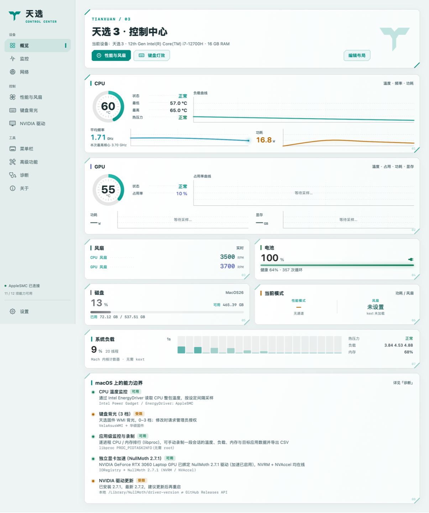
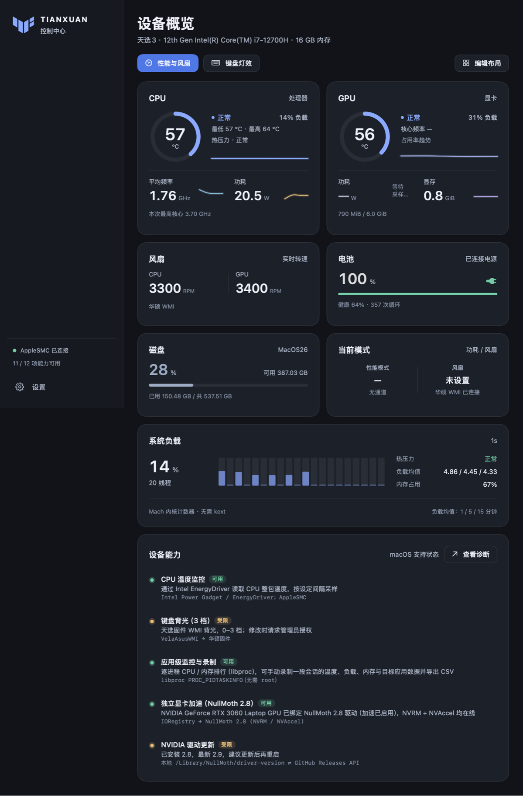

# 天选控制中心 / Tianxuan Control Center

> 以华硕天选 3 为设计主题的 macOS 笔记本控制中心 —— [G-Helper](https://github.com/seerge/g-helper) 的 macOS 对应实现。  
> 性能模式、风扇曲线、键盘背光与 Aura 灯效、传感器监控、菜单栏多指标、NVIDIA 驱动管理，  
> 采用原生 SwiftUI，以月耀白、薄荷青与切角机甲面板呈现设备状态。

本地适配机型为 **天选 3 FX507ZM（i7-12700H / RTX 3060）**。硬件控制需要配套驱动；详见 [FX507ZM-适配说明.md](FX507ZM-适配说明.md)。

- 版本：**2.4.28**（build 106）
- 界面：默认 **天选白青**，同时支持深色、浅色与跟随系统
- 最低系统：**macOS 13.0**
- 架构：Universal（x86_64 + arm64）
- 许可证：[GPLv3](#许可证)

> 本项目与华硕（ASUS）无任何官方关联，是社区第三方实现。详情见文末[商标声明](#商标声明)。

---
## 截图预览





新界面统一使用中文分组侧栏、切角卡片、薄荷青操作按钮和清晰的数字仪表。概览提供性能与键盘灯效快捷入口，并支持编辑布局。旧 ROG 图片与 550W 装饰素材已移除；应用图标与侧栏采用 TUF Gaming 几何徽记，启动图标使用石墨灰底板与银白前景。

## 功能

| 模块        | 说明                                                           |
| --------- | ------------------------------------------------------------ |
| 性能与风扇     | 性能模式切换；双风扇实时转速；**三档模式**（静音 / 平衡 / 增强）；FX507ZM 使用 ASUS WMI 固件策略 |
| 键盘背光      | HID 写入（report ID `0x5A`），0–3 档亮度                             |
| Aura 灯效   | HID 写入（report ID `0x5D`），12 种灯效模式                            |
| 传感器监控     | CPU / GPU 温度、负载、频率、内存、网速、功耗                                  |
| 菜单栏       | 可勾选 7 项指标实时拼接进菜单栏标题                                          |
| NVIDIA 驱动 | 检查 / 下载 / 安装 NullMoth 的 macOS NVIDIA 驱动                      |
| 命令行       | 同源 CLI：`vela status` / `vela fan ...` / `vela aura ...`      |

---

## 环境要求

- 设备控制需要一台通过 **OpenCore** 运行 macOS 的受支持华硕笔记本；原生 Mac 可构建和打开界面，但没有对应的 ASUS 硬件控制通道
- macOS 13.0+
- 使用 Xcode 构建时安装完整 Xcode；本次验证使用 **Xcode 26.5**。使用 `build.sh` 时仅需 Command Line Tools
- FX507ZM 的模式与风扇控制使用已验证的 ASUS WMI 驱动；其他机型按实际硬件能力选择 SMC 通道

---

## 构建

### 在 Xcode 中运行

1. 打开项目根目录的 `天选控制中心.xcodeproj`。
2. 在顶部选择 **天选控制中心** scheme，运行目标选择 **My Mac**。
3. 按 **⌘B** 编译，按 **⌘R** 启动界面。

项目默认使用本机 ad-hoc 签名，构建运行无需选择开发者团队。硬件驱动的构建与应用构建相互独立；打开界面不会自动安装驱动。

也可以在项目根目录用完整 Xcode 的命令行构建：

```bash
xcodebuild -project '天选控制中心.xcodeproj' \
  -scheme '天选控制中心' -configuration Release \
  -derivedDataPath build/DerivedData-Tianxuan \
  ONLY_ACTIVE_ARCH=NO build
```

产物位于 `build/DerivedData-Tianxuan/Build/Products/Release/天选控制中心.app`。本次已验证 Debug、Release 的 Universal 构建、代码签名，以及实际窗口启动和页面切换；硬件写入操作未在此次界面验证中执行。验证后的 Release 成品另存为 `build/天选控制中心.app`。

### 使用构建脚本

只安装 Command Line Tools 也可以构建应用：

```bash
xcode-select --install          # 若尚未安装命令行工具

./build.sh                      # 编译 → build/天选控制中心.app
./build.sh --dmg                # 编译 + 打包 → dist/天选控制中心-<版本>.dmg
./build.sh x86_64               # 只编指定架构
```

### 签名（推荐但非必须）

本程序需要 **「输入监控」** 权限才能写键盘背光和 Aura 灯效。该权限按代码签名（cdhash）记录，  
而 ad-hoc 签名的 cdhash **每次编译都会变**，导致授权反复失效。所以建议先用本地自签证书：

```bash
./Tools/make_signing_cert.sh    # 只需跑一次，证书存于独立钥匙串
./build.sh                      # 之后自动用它签名（TCC 授权稳定）
```

若钥匙串被锁定，构建前先解锁：

```bash
security unlock-keychain "$HOME/Library/Keychains/asuscontrol-signing.keychain-db"
```

不创建证书也能跑，只是每次重编译后需要重新勾选「输入监控」。

---

## FX507ZM 模式与监测

「增强」通过 ASUS WMI 写入固件性能策略，普通 OEM 预设不会额外写自定义风扇曲线。
风扇每 500 毫秒读取一次，页面只显示实际读数。CPU 温度、平均频率、最高核心频率和封装功耗通过 Intel 动态接口与 SMC 获取；缺少读数时显示不可用。

CPU 的频率由系统调度、负载、温度和供电共同决定，软件未提供最低频率锁定。此前出现的持续 0.4 GHz 尚未复现并定位，不能据此宣称已解决。风扇是否超过 4000 RPM 取决于固件和温度。

下面的旧 SMC 曲线说明适用于对应 SMC 通道机型；FX507ZM 不使用旧 EC/MMIO 回退路径。

## 风扇曲线（需要 SMCAsusFan.kext）

「性能与风扇」页能读双风扇转速、切换三档曲线（静音 / 平衡 / 性能）：

- 读状态免 root：转速走 `F0Ac` / `F1Ac`，kext 是否在跑看 `AFMd`
- 切档位要写 SMC 键（`AFMf` + `AFW1..4` + `AFWg`），点「应用」时用系统授权提权一次，程序本身**不常驻 root**
- 曲线配置随包发布（`Resources/fan_presets.json`），也支持 `~/Library/Application Support/SMCAsusFan/fan_presets.json` 覆盖
- 命令行同源：`vela fan status` / `vela fan list` / `vela fan set <档位>`

命令：

```bash
vela fan status                              # kext 版本 + 双风扇转速（免 root）
vela fan list                                # 三档曲线摘要
sudo vela fan set silent|balanced|performance   # 下发曲线（写 SMC 需 root）
```

> ⚠️ 写 EC 风扇曲线有风险：错误的曲线可能导致风扇失控。操作前建议用  
> `tools/curve.py read 0` 备份原始曲线；真出问题时断电重启即可回到出厂曲线。

### 机型与 EC 配置识别

不同机型的 EC（嵌入式控制器）布局不同——MMIO 地址、邮箱寄存器、曲线格式、风扇数量都不一样。
**把 A 机型的曲线写进 B 机型，可能损坏硬件。** 所以程序会先做机型识别，并在不一致时强制确认。

程序从 EC / 电池上报的 `DeviceName` 读取真实 ASUS 型号代码（如 `GA50358`），OpenCore 的 SMBIOS
伪装不会覆盖它。识别结果分三档，显示在「性能与风扇」页顶部的机型卡上：

| 状态 | 含义 | 能否下发曲线 |
|---|---|---|
| ✅ **机型匹配** | 检测到的机型与所选 EC 配置一致（或属于同一机型族） | 可以直接下发 |
| ⚠️ **未收录机型** | 检测到的机型不在已知目录里，沿用默认配置 | 可以下发，但需知悉风险 |
| ⛔ **机型不匹配** | 检测到的机型与所选配置不是同一族 | **必须先确认免责声明** |

**机主可以手动选择机型**（按 model 名，例如 `G513RM`）：机型卡上有已知机型菜单，
也可以直接输入型号代码。一旦所选机型与检测到的硬件**不属于同一机型族**，页面会显示红色警告卡，
点「查看风险并继续」后弹出免责声明，逐条说明可能的后果（风扇失控、EC 锁死、散热失效导致
CPU/GPU 过热降频甚至永久损坏、电池与供电异常、保修失效），**必须显式确认才允许下发曲线**。

命令行同源：

```bash
vela model                     # 显示检测到的机型、所选机型、匹配状态、EC 配置
vela model set G513RM          # 手动选择机型（不匹配时会打印免责声明并拒绝）
vela model set G513RM --i-understand   # 不匹配但确认风险，强制写入
vela model clear               # 清除手动选择，回到自动检测
```

**「机型能对上」不等于「曲线在这台机器上跑过」**，所以每个机型还带一个 `verification` 标记：

- `verifiedOnDevice` —— 已在本机型实机下发过，转速/温度响应符合预期
- `reverseEngineered` —— EC 布局已逆向确认，但曲线**没在这台机器上实机验证过**。
  界面与 CLI 都会显示黄色提示，要求先做只读验证（能读到转速且随负载变化），
  再下发曲线并观察转速是否真的响应

给新机型加支持，往 `Sources/Hardware/ASUS/ECProfiles.swift` 的 `catalog` 加一条，曲线放到
`Resources/fan_presets-<MODEL>.json`（`build.sh` 会带进 bundle），其它代码不用动：

```swift
ECProfile(
    modelCodes: ["G713PV", "G713PI", "G713PY", "G713P"],
    familyPrefixes: ["G713P"],
    familyName: "ROG Strix G17 / 魔霸7 Plus (2023)",
    ecChip: "ITE IT5571",
    ecFirmware: "ITE EC-V14.6",
    curvePoints: 8, tempMin: 20, tempMax: 110, dutyMin: 0, dutyMax: 100,
    mmio: ["it55": "0xFE700600", "mb00": "0xFE700B00", "mc00": "0xFE700C00"],
    note: "...",
    source: "内置",
    verification: .reverseEngineered      // 没有实机验证过就别写成 .verifiedOnDevice
)
```

> `familyPrefixes` 要收窄到已验证的范围。比如魔霸7 Plus 只写 `G713P` 而不是 `G713`，
> 否则会把魔霸6 Plus（G713RW / G713RS，2022）也吸进来套用未验证的曲线。
> 收窄后 6 Plus 会落到「未收录」（没有 EC 配置），而不是被当成「兼容」放行 —— 宁可不给，也不给错的。

> 新机型的 MMIO / 邮箱寄存器需要重新逆向。交付包里的 `tools/mkconfig.py --capture`
> 可以从 Windows 下的 Armoury Crate 抓取通信记录，再用 `mkconfig.py` 生成配置。

### 确认实际用的是哪份曲线

多机型共存时，**三档曲线的数值可能完全一样**（例如魔霸7 Plus 沿用了幻15 的实测值），
光看数值分辨不出加载了哪份文件。`vela fan list` 会打印来源：

```bash
$ vela model set G713PV --i-understand
$ vela fan list
来源         .../Resources/fan_presets-G713PV.json
针对机型     ASUS ROG Strix G17 G713PV
```

---

## 目录结构

```text
Sources/
  App/           应用启动、命令行、版本信息
  Core/          模型、控制器、采样、偏好、格式化
  Hardware/      ASUS WMI、SMC、Intel、AMD、HID、NVIDIA、系统信息
  Services/      授权、登录启动、更新、显示、记录
  UI/            页面、导航、窗口、菜单栏、控件、主题
Resources/       图标、Info.plist、机型资源
Drivers/         驱动源代码；应用构建不会安装驱动
Tests/           硬件协议与控制状态回归测试
Tools/           构建、打包和辅助工具
天选控制中心.xcodeproj/
build.sh         递归收集分层后的 Swift 源文件
```

具体责任边界见 [ARCHITECTURE.md](ARCHITECTURE.md)，改名兼容说明见 [MIGRATION.md](MIGRATION.md)。

---

## 权限

首次运行需要在「系统设置 → 隐私与安全性」中授予：

- **输入监控**：键盘背光与 Aura 灯效（HID 写入）
- **辅助功能 / 管理员密码**：部分需要提权的操作（驱动安装、风扇控制）

TCC 授权在进程启动时读取一次，**授权后需要重启 App** 才生效。

---

## 协议要点（改动前务必确认）

- 亮度通道：report ID `0x5A`，载荷 `5A BA C5 C4 <level>` 补零到 64 字节，首字节必须是报告 ID。
- Aura 通道：report ID `0x5D`，效果 `5D B3 ...`（17 字节）→ 提交 `5D B5 00 00 00` → 应用 `5D B4`。
- 两个通道不能混用；HID 设备筛选优先按产品名含 `N-KEY`，不要按「有 feature report」过滤。

---

## 自测与界面预览

无需 UI 交互即可启动窗口、等待采样并自动退出。自测模式会跳过登录启动迁移及开机/唤醒自动下发，避免界面验证触发硬件写入：

```bash
ASUS_SELFTEST=1 ASUS_PAGE=overview ASUS_THEME=dark ASUS_SELFTEST_DELAY=10 \
  "./build/天选控制中心.app/Contents/MacOS/AsusControl"
# 约 10 秒后把窗口截图写到 /tmp/live_window.png 并退出
```

- `ASUS_PAGE` 可选：`overview`、`performance`、`monitor`、`network`、`keyboard`、`menubar`、`nvidia`、`diagnostics`、`advanced`、`settings`、`about`。
- `ASUS_THEME` 可选：`tianxuan`（天选白青）、`dark`、`light`、`system`。

离屏生成文档配图（需要 macOS 14+）：

```bash
ASUS_THEME=tianxuan "./build/天选控制中心.app/Contents/MacOS/AsusControl" \
  snapshot /tmp/tianxuan-overview.png 1140 860 overview
```

离屏渲染会展开页面内容，图片可能超过指定高度；部分 AppKit 原生控件不支持离屏渲染，完整交互效果以实际窗口为准。新图标可用 `swift Tools/make_icon.swift build/DesignPreview` 重新生成，再用 `iconutil` 将输出的 `AppIcon.iconset` 转为 `Resources/AppIcon.icns`。

---

## 安全与风险提示

- 本程序直接读写笔记本的 **EC（嵌入式控制器）** 与 **SMC**。错误的写入可能改变风扇行为、  
  背光逻辑甚至温度保护策略。请在理解后果的前提下使用，**作者不对任何硬件损坏负责**。
- 它会请求「输入监控」权限（用于 HID 写入背光），这是 macOS 正常的硬件控制机制，  
  但请只从可信来源运行。
- 程序**不常驻 root**，仅在需要下发风扇曲线 / 安装驱动时通过系统授权弹窗提权一次。
- 这并非华硕官方软件，**使用本程序可能导致保修失效**，请自行权衡。

---

## 商标声明

- **ASUS、天选、ROG / Republic of Gamers** 等厂商及产品名称属于各自权利人；兼容机型目录中的产品名称仅用于设备识别。
- 本项目为社区第三方软件，与华硕无隶属关系。当前界面与启动图标使用原创几何徽记，未使用旧 ROG 品牌图片。
- 所有厂商名、产品名为其各自所有者的财产。

---

## 贡献

欢迎 Issue 和 Pull Request。

- 提 Bug 请附：`vela status` 输出、macOS 版本、机型、kext 状态
- 改协议 / 灯效前请先读上面的[协议要点](#协议要点改动前务必确认)
- 本地构建见[构建](#构建)；提交前请确保 `./build.sh` 通过、无遗留 `build/` 产物

---

## 许可证

[GPLv3](LICENSE) © 2026 XelonJangs

本项目基于 **GNU General Public License v3.0** 发布。你可以自由使用、修改、再分发，  
但任何分发（含修改版）都必须以相同许可证开源全部源代码。

## 致谢

- [G-Helper](https://github.com/seerge/g-helper) — 原始 Windows 实现与思路来源
- 奥创中心（Armoury Crate）— 设备协议参考
- [NullMoth](https://github.com/nullmoth/nvidia-macos-driver) — macOS NVIDIA 驱动
- angus666888 — EC 灯效修复思路
- [zzzyy678](https://github.com/zzzyy678/SMCNvidiaGPU) - GPU功耗及显存占用

## 捐赠
本项目用全程开源，如果您觉得好用，可以请我喝杯快乐水助力我后续开发，谢谢！


